# ScopeRoom

**Turn vague requests into agreed, testable project scope.**

ScopeRoom is a collaborative workspace where a small team and its stakeholders map a process as a flow, link written requirements to the evidence they came from, ask AI for suggestions they review before anything changes, and approve one exact, immutable version of the scope. Newer work keeps going in the draft while the approved version stays fixed and exportable.

**Live app:** <https://scoperoom-ai.vercel.app/app> (pilot with synthetic data; sign up with your email)

[](https://github.com/cyrusnguyen/scoperoom-ai/actions/workflows/ci.yml)

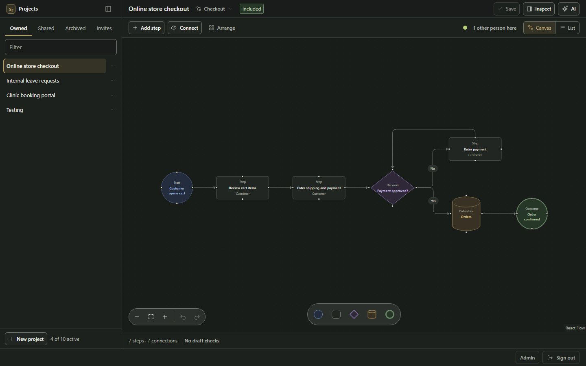

## Contents

- [Why ScopeRoom](#why-scoperoom)
- [Features](#features)
- [Screenshots](#screenshots)
- [Tech stack](#tech-stack)
- [Architecture](#architecture)
- [Technical decisions](#technical-decisions)
- [Getting started](#getting-started)
- [Testing](#testing)
- [Deployment](#deployment)
- [Project structure](#project-structure)
- [Status and roadmap](#status-and-roadmap)
- [Documentation](#documentation)

## Why ScopeRoom

Project scope usually lives in meeting notes, chat threads and slide decks. Nobody can point to the exact version that was agreed, requirements drift away from the conversations that produced them, and AI tools rewrite documents with no review step. ScopeRoom keeps the whole path in one place:

1. **Map the work** as flows of steps, decisions, data stores and outcomes.
2. **Capture evidence** (meeting notes, briefs, emails) as immutable sources.
3. **Write requirements** that cite exact lines of that evidence and link to the steps they affect.
4. **Ask AI** to draft or improve a flow, then review every proposed change before applying it.
5. **Freeze and approve** an exact candidate. The approval names a person, a time and a content hash.
6. **Hand off** the approved scope as Markdown while the team keeps editing the next draft.

The manual path works end to end without AI.

## Features

**Flow Studio**
- Canvas and list views of each flow, built on React Flow, with five shape kinds: start, step, decision, data store and outcome.
- Drag from the shape panel, edit labels inline, connect any side of a step, undo and redo, and automatic layout (Arrange) with a preview before applying.
- Every edit is queued locally and saved as one version-checked batch (Save, a 10 second autosave, or before a switch). A refused save shows exactly what someone else changed, with Keep theirs, Apply my changes again or Discard.
- Import and export of the native JSON format, with a preview before import.

**Real-time collaboration**
- Live presence, cursors and drag previews over private Supabase Realtime channels.
- Saved changes by others appear without a reload. Realtime only hints that new data exists; content is always read through the authenticated API.
- When Realtime is unavailable the app says "Live updates delayed" and keeps saving through polling.
- Owner, editor, reviewer and viewer roles. Invitations are single-use links the owner copies and shares.

**Evidence and scope**
- Sources: pasted or uploaded text, stored as immutable versions. Corrections create a new version, and old versions stay readable.
- Requirements grouped as Included, Undecided and Excluded, with category, owner, verification text, confirmation and citations to exact source lines.
- Trace links between requirements and flow steps, reviewed when either side changes.

**AI proposals with human review**
- Generate a new flow from a description, or Improve selected steps.
- Every run is captured with its exact input. The result is a typed proposal that is validated before anyone sees it.
- The review shows a preview of the changed flow. People apply all changes or a dependency-complete subset, exactly once. AI never approves anything.
- Bounded cost: a per-account allowance (5 requests in total and 30 a day by default), charged to the project owner and shown in the AI panel.
- Model choice is a single setting: Anthropic Claude (default `claude-sonnet-5-5`) or Google Gemini.

**Review and approval**
- Preview checks that the saved scope is complete and consistent, then Freeze copies the exact document, layout, cited source versions and approval policy into an immutable snapshot.
- A designated approver approves, requests changes or rejects, with a reason.
- Publishing keeps newer draft work. History lists every baseline and candidate, and each opens read-only.
- Approved Markdown export of the exact baseline.

**Accounts and staff tools**
- Email sign-up with a six-digit code, password reset, and verified sessions through Supabase Auth.
- Admin and Moderator roles with a staff accounts screen: search, usage, per-account project and AI limits with expiry, blocking, and an audit history of every change.

**Accessibility and responsive layout**
- Keyboard operation, visible focus, screen reader labels and reduced motion support across the Studio and panels.
- Resizable, dockable side panels, and layouts that work down to 320 px.

## Screenshots

| Live collaboration | Invite and members |
| --- | --- |
| 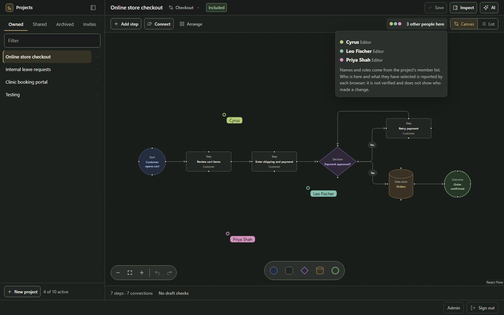 | 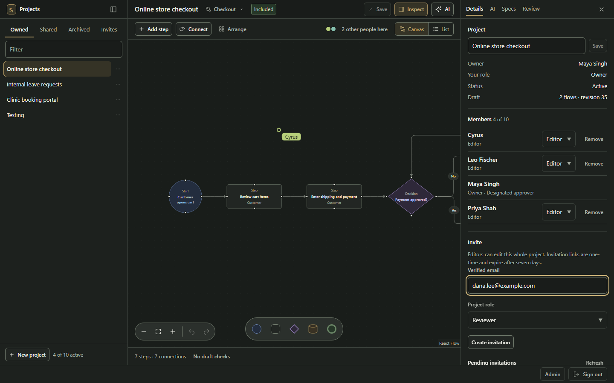 |
| **AI proposal review** | **Evidence and scope** |
| 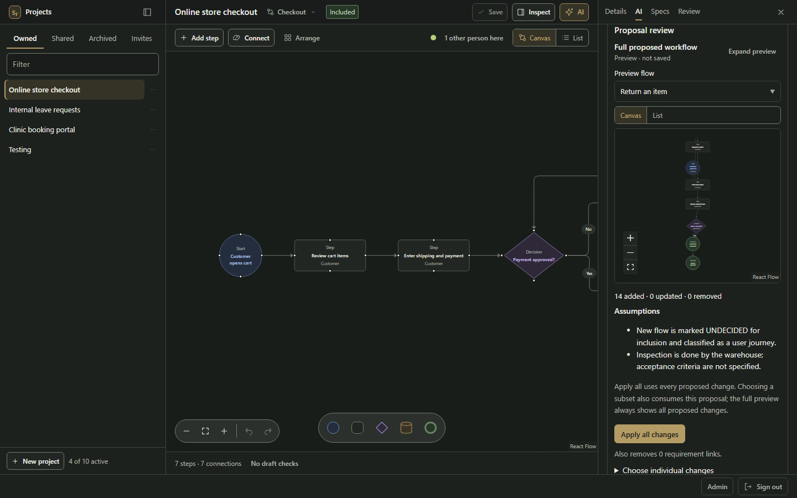 | 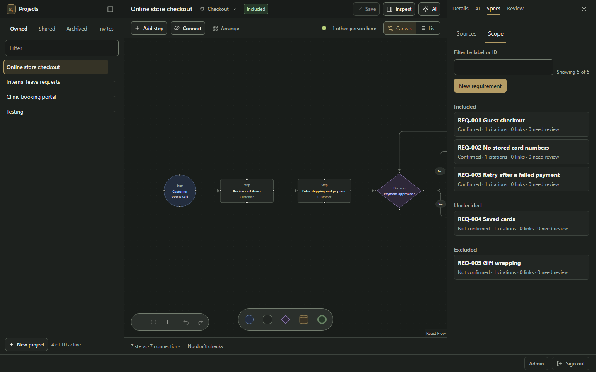 |
| **Approved baseline** | **Flows menu** |
| 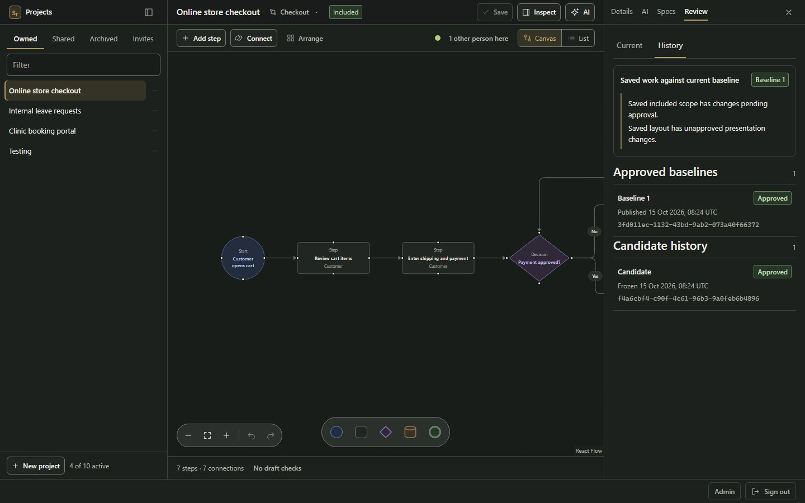 | 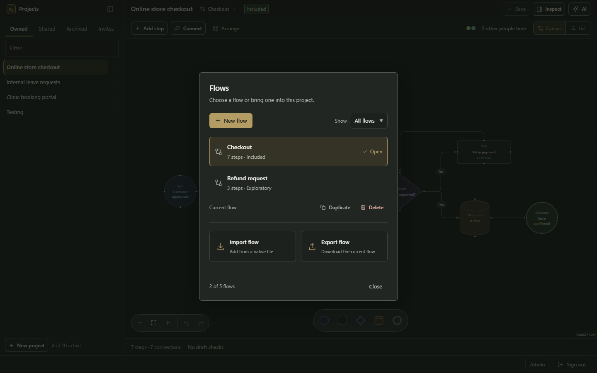 |
| **Export flow** | **Import preview** |
| 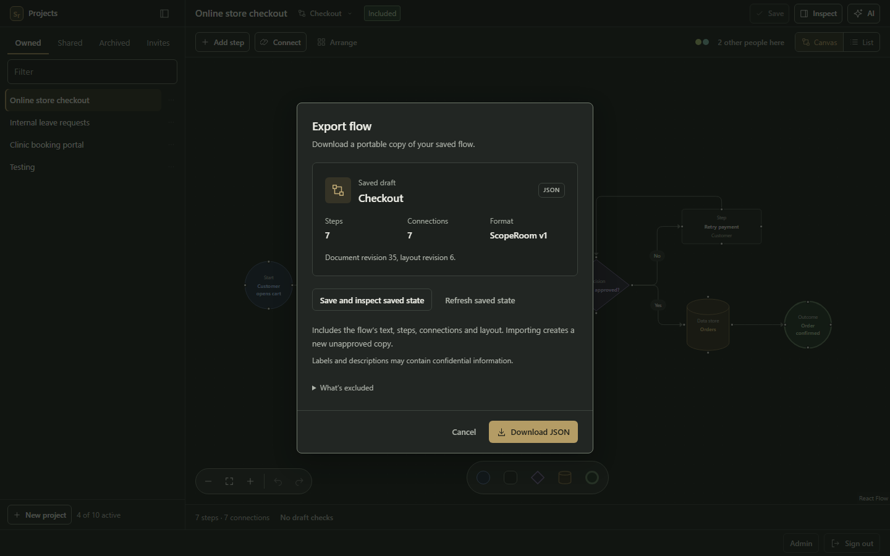 | 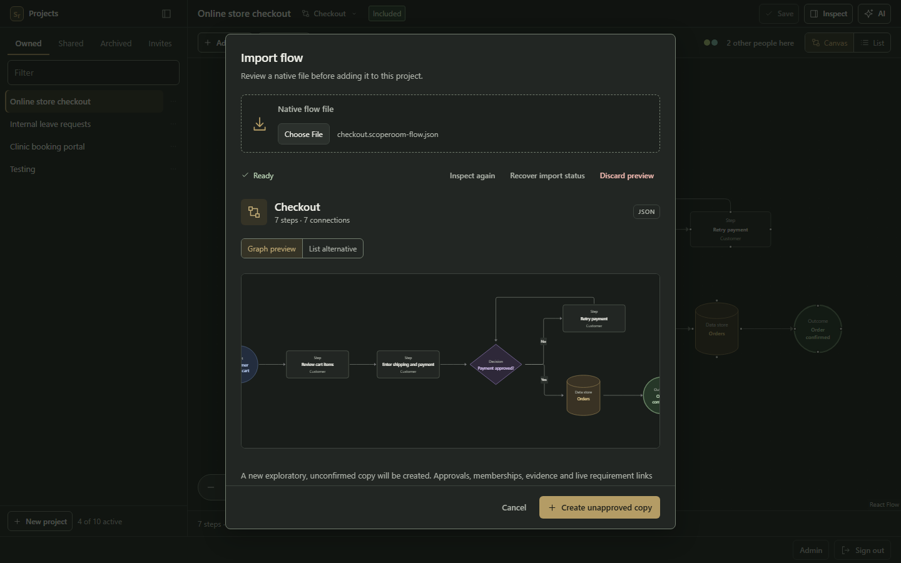 |
| **Staff accounts** | **Sign in** |
| 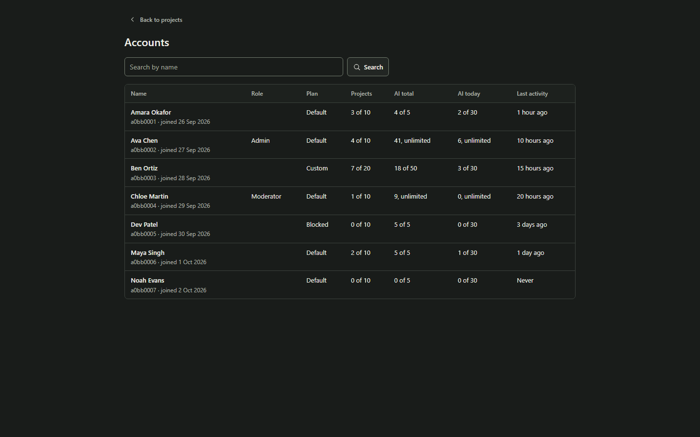 | 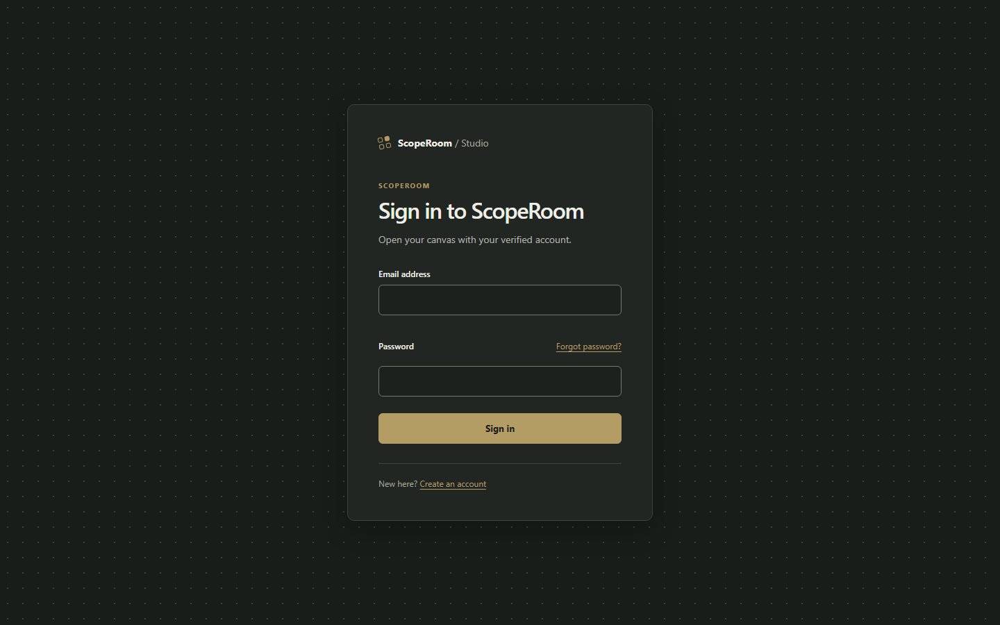 |
| **Phone layout** | |
| 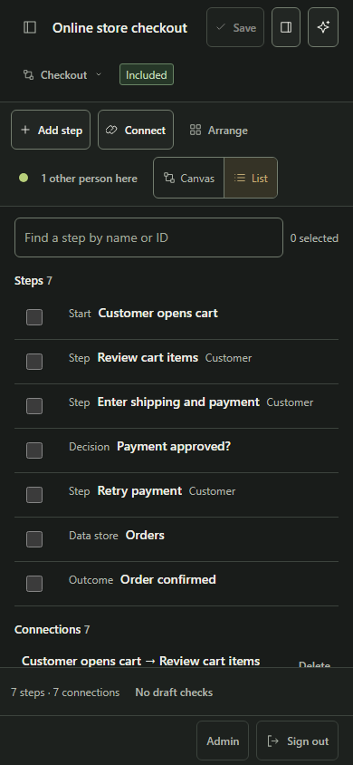 | |

The screenshots come from the live app with a demo project and four of its members working at once; the AI proposal is a real Claude result. The staff screen shows sample accounts, so no real users appear.

## Tech stack

| Area | Technology |
| --- | --- |
| Application | [Next.js 16](https://nextjs.org) (App Router), [React 19](https://react.dev), TypeScript 6 |
| Flow canvas | [React Flow](https://reactflow.dev) (`@xyflow/react`), [dagre](https://github.com/dagrejs/dagre) for server-side layout |
| Database | PostgreSQL 17 on [Supabase](https://supabase.com), [Prisma 7](https://www.prisma.io) with the `pg` driver adapter |
| Auth | Supabase Auth (email code sign-up, password recovery, SSR cookie sessions) |
| Real-time | Supabase Realtime: private channels for presence, previews and change hints |
| AI | [Vercel AI SDK](https://ai-sdk.dev) with Anthropic Claude and Google Gemini providers |
| Background jobs | [Inngest](https://www.inngest.com) for AI runs; Supabase `pg_cron` and `pg_net` for maintenance |
| Hosting | [Vercel](https://vercel.com): one web project and one worker project, deployed by GitHub Actions |
| Testing | Node's built-in test runner (unit, integration, worker and Realtime suites), [Playwright](https://playwright.dev) (browser) |
| Tooling | pnpm through Corepack, ESLint with an import-boundary check, Supabase CLI for the local stack |

## Architecture

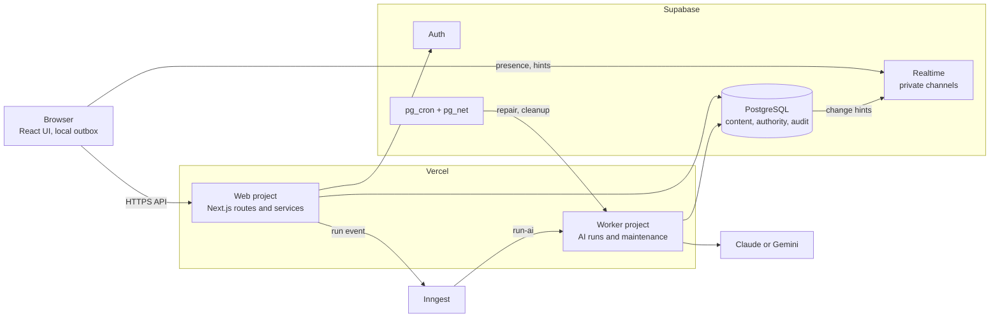

- **PostgreSQL is the source of truth.** Saved content, node positions, membership, AI runs, budgets, receipts and the audit log all live there. Authorization is checked inside each transaction.
- **The web project** serves the UI and a JSON API of thin routes over feature services. Every write carries an `Idempotency-Key` and the version it was based on.
- **The worker project** is built from the same commit but serves only the Inngest endpoint and two secret-protected maintenance endpoints. Model credentials live only there.
- **Realtime never carries saved content.** It carries presence, short-lived previews and "something changed" hints; the browser then reads through the API.

## Technical decisions

| Decision | Why |
| --- | --- |
| One PostgreSQL authority for content, positions and permissions | One transaction can check access, versions and limits together, so there is no second store to drift. |
| Optimistic local outbox with batch saves | Editing feels instant; a save is one all-or-nothing request with explicit conflict recovery instead of silent overwrites. |
| Idempotency keys and scoped receipts on every write | A retry after a lost response replays the stored result instead of applying a change twice. |
| Version checks on every write (document, layout, entity and position versions) | Concurrent edits are detected precisely; a moved step never overwrites a renamed one. |
| Realtime for hints only | A lost or forged message cannot change saved data; correctness never depends on socket delivery. |
| Scoped Realtime credentials minted by the server | The browser never hands its Auth session to Realtime; tokens last five minutes and carry only project scope. |
| AI proposes, people apply | Runs capture their exact input, results are validated against a schema, and Apply is reviewed, exactly once and version checked. |
| Budgets reserved in SQL before a model call | The allowance cannot be overspent by retries or parallel runs; unused reservations are refunded. |
| Separate worker deployment | Model keys and long-running work stay off the public web project. |
| `pg_cron` for maintenance, Inngest only for AI | Scheduled repair and cleanup cost no job executions and cannot be paused by job-platform failure limits. |
| Immutable snapshots for approval | An approval points at exact content and hashes; publishing never discards newer draft work. |
| Restricted database roles | The web and worker runtimes log in as separate roles with only the grants they need; migrations use a third role. |
| Import boundaries enforced in lint | Server-only code and the layout library cannot leak into the browser bundle. |

## Getting started

### Prerequisites

- Node.js 24.21 or later and Corepack (it provides the pinned pnpm 10.34.5)
- Docker, for the local Supabase stack
- A POSIX shell (Git Bash on Windows), for the setup scripts

### 1. Install

```bash
corepack enable
corepack pnpm install --frozen-lockfile
corepack pnpm db:generate
```

### 2. Start the local Supabase stack

```bash
bash scripts/ci/start-local-supabase.sh
```

This starts Supabase on a loopback-only Docker network and waits until the database and Auth are ready. The database scripts only work on a local database reachable from your own machine alone, because the local stack uses well-known passwords. The API is on port 54321, the database on 54322 and Mailpit (local email) on 54324.

### 3. Create `.env.local`

The CI helper scripts write every local setting into the file named by `GITHUB_ENV`:

```bash
GITHUB_ENV=.env.local bash scripts/ci/export-local-db-env.sh
GITHUB_ENV=.env.local bash scripts/ci/export-local-auth-env.sh
```

Then set `NEXT_PUBLIC_APP_URL=http://127.0.0.1:3100` in `.env.local`, the origin of the dev server. Writes are accepted only from that origin. See [`.env.example`](.env.example) for every setting and what reads it. `.env.local` is ignored by Git.

### 4. Create the database

```bash
corepack pnpm db:bootstrap
```

This verifies the target is the local stack, creates the restricted roles, applies every migration and enables private Realtime.

### 5. Run the app

```bash
corepack pnpm dev
```

Open <http://127.0.0.1:3100/signup>, create an account and enter the six-digit code from Mailpit at <http://127.0.0.1:54324>.

AI runs need a model key and Inngest, so they are off locally by default: a started run waits and is refunded at its deadline. See [AI setup](docs/ai-setup.md) to enable them. To try the staff screens, run `node --env-file=.env.local scripts/db/grant-admin.mjs <your email>` once.

### Useful commands

| Command | What it does |
| --- | --- |
| `corepack pnpm dev` | Development server on port 3100 |
| `corepack pnpm build` | Production build |
| `corepack pnpm lint` | ESLint plus the import-boundary check |
| `corepack pnpm typecheck` | TypeScript, no emit |
| `corepack pnpm test:unit` | Unit tests, no database needed |
| `corepack pnpm test:integration` | Database integration tests against the local stack |
| `corepack pnpm test:workers` | AI worker and maintenance tests |
| `corepack pnpm test:realtime` | Real Realtime socket tests (run alone) |
| `corepack pnpm test:e2e:production` | Browser suite against a production build |
| `corepack pnpm db:migrate` | Apply new migrations to the local stack |

## Testing

ScopeRoom is tested at the level where each behavior can actually break:

- **Unit tests** (about 720) cover pure contracts, the graph domain, the outbox, formatting and parsers.
- **Database integration tests** cover authorization, transactions, version checks, idempotent replay, locking races and retention, against real PostgreSQL with the runtime roles the app uses.
- **Worker and Realtime suites** run the AI worker services with fake model ports, and open real Realtime sockets to check private channel authorization.
- **Browser tests** (Playwright, about 500 cases) drive real sign-in, editing, collaboration between two users, conflicts, AI review, approval and the staff screens, including 320 px layouts and keyboard paths.

Every pull request runs three CI jobs: lint, typecheck, unit tests and build; the database suites on a fresh local stack; and the browser suite on a production build. More detail is in [docs/testing.md](docs/testing.md).

## Deployment

Releases are automated with GitHub Actions ([`release.yml`](.github/workflows/release.yml)). A successful CI run on `main` queues a release that waits for one-click approval in a protected `release` environment. The release then:

1. applies pending migrations with the protected migration credential,
2. sets the release binding on both Vercel projects,
3. deploys the worker from a clean source export and registers it with Inngest,
4. deploys the web project,
5. verifies the maintenance schedule, runs edge checks on both origins and a hosted smoke test of the core journey.

A manual run can release a chosen commit and optionally include an AI smoke test. The [hosted pilot runbook](docs/hosted-pilot.md) covers configuration, first-time setup, aborting a release and known limitations.

## Project structure

```text
src/
  app/                 Next.js routes, kept thin
  features/<feature>/  contracts, domain, server and ui for one feature
    access/            sign-up, sign-in, password recovery
    projects/          projects, membership, invitations, plans
    drafts/            the saved document and layout, commands, saves
    studio/            canvas, list, shape panel, inspector
    collaboration/     sync controller, Realtime, presence
    sources/, scope/   evidence and requirements
    proposals/         AI runs, budgets, proposal review
    reviews/           candidates, approval, history, Markdown
    admin/             staff roles and the accounts screen
  client/              shared browser helpers
  server/              trusted server infrastructure
  worker/              Inngest functions and maintenance
prisma/                schema and SQL migrations
supabase/              local stack config and email templates
scripts/               database, CI and release tooling
tests/                 unit, integration, worker, Realtime and e2e suites
docs/                  setup guides, runbook and project context
```

## Status and roadmap

ScopeRoom is running as a hosted pilot with synthetic data and invited users.

**Done**
- Access, projects and invitations
- Manual Studio with saves, conflicts, Arrange, import and export
- Real-time collaboration
- Durable AI runs with reviewed Apply and per-account budgets
- Sources, requirements and trace links
- Review, approval, history and approved Markdown export
- Automated releases, staff roles and account limits

**Planned**
- Acceptance scenarios and coverage review
- Questions, answers and decisions with an activity view
- Change requests and impact analysis between baselines
- Before any real customer data: permanent project deletion, a tested restore from backup, and a review of each provider's data handling

## Documentation

- [Project context](docs/context/README.md): overview, architecture, code standards and the progress tracker
- [Testing](docs/testing.md)
- [Auth setup](docs/auth-setup.md), [Realtime setup](docs/realtime-setup.md) and [AI setup](docs/ai-setup.md)
- [Hosted pilot runbook](docs/hosted-pilot.md)
- [Maintenance](docs/maintenance.md)
